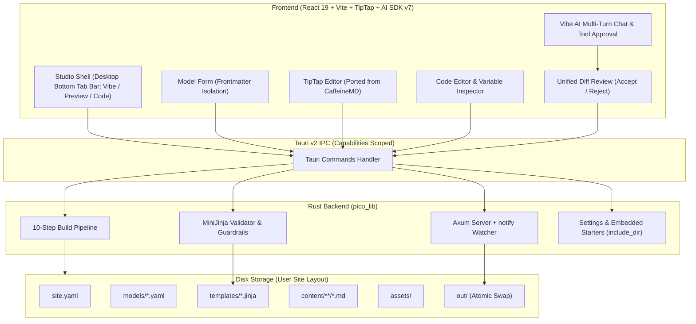

# System Patterns: Pico

## System Architecture

## State Machine & Lifecycles

### 1. TipTap Editor Lifecycle (Ported from CaffeineMD)
- Mounted cleanly inside React via `@tiptap/react` (`useEditor` + `EditorContent`).
- Markdown body loaded via `markdownToEditorHtml`. Frontmatter is isolated in the Post Properties form.
- Debounced auto-save (300ms) marks post Unsaved until Tauri's `save_post` succeeds.
- External updates (switching posts, Vibe Accept) invoke `editor.commands.setContent(targetHtml, { emitUpdate: false })` without remounting the editor or losing cursor focus.

### 2. Vibe Conversational AI & Tool Approval Pattern
- Built with official Vercel AI SDK v7 (`ai` Core, `@ai-sdk/react`, `@ai-sdk/google`, `@ai-sdk/openai`).
- Frontend-direct execution inside the Tauri webview; keys obtained at call-time via IPC (`get_llm_key`).
- Strictly limited to 4 tools: `readContentFile`, `readTemplateFile`, `readThemeCss`, `proposeEdit`.
- Tool approval gate: `toolApproval: { proposeEdit: 'user-approval' }`. Edits are NEVER applied autonomously. Proposed edits display as unified diff cards with **Accept & Save** and **Reject**.
- Multi-turn conversation history, streaming assistant replies, and strict no-key safety rule.

### 3. Template Guardrail Pattern
- Dotted variables inside `{{ ... }}` and `` (e.g. `post.author_bio`, `site.unknown`) are checked against allowed model fields and `site.yaml` properties.
- In `macros/*.jinja`, `varargs` and `kwargs` are prohibited; top-level HTML outside `` is rejected.
- On save, the previous version is backed up on disk and in memory. One-click Revert restores the exact previous version.

### 4. Atomic Build Pipeline Pattern
- Compilation always builds into `out.tmp/`.
- If any validation or render errors occur, `out.tmp/` is purged and errors are reported to the GUI with file and line. The previous working `out/` folder is left untouched.
- On success, `out.tmp/` is atomically swapped into `out/`.

### 5. Zero-Remount Desktop 3-Tab Shell Pattern
- Tab order: **Vibe**, **Preview**, **Code** strictly in the bottom desktop dock. Topnav contains zero tab buttons.
- All three views remain permanently mounted; CSS display toggling ensures zero-remount state preservation across tab switches.
