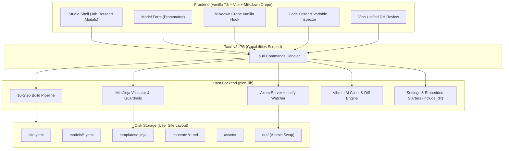

# System Patterns: Pico

## System Architecture

## State Machine & Lifecycles

### 1. Editor Lifecycle (`useCrepeEditorEffect`)
- Mounted without React/Vue wrappers into a vanilla DOM node.
- Debounced auto-save triggers 2 seconds after the user stops typing.
- On save, frontmatter is validated against the model schema, formatted into YAML headers, concatenated with clean Markdown body, and saved to disk.
- Unsaved changes flag prompts the user before switching sites or closing the application.

### 2. Template Guardrail Pattern
- Dotted variables inside `{{ ... }}` and `` (e.g. `post.author_bio`, `site.unknown`) are checked against allowed model fields and `site.yaml` properties.
- In `macros/*.jinja`, `varargs` and `kwargs` are prohibited; top-level HTML outside `` is rejected.
- On save, the previous version is backed up in memory (`AppState.template_backups`) and on disk (`.pico_history/templates/`).
- One-click Revert restores the exact previous version without requiring Git.

### 3. Atomic Build Pipeline Pattern (§6)
- Compilation always builds into `out.tmp/`.
- If any validation or render errors occur, `out.tmp/` is purged and errors are reported to the GUI with file and line. The previous working `out/` folder is left untouched.
- On success, `out.tmp/` is atomically renamed or swapped into `out/`.

### 4. Zero-Dependency Embedded Starters Pattern
- `static EMBEDDED_STARTERS: Dir = include_dir!("$CARGO_MANIFEST_DIR/../starters")`.
- `create_site_impl` checks disk directory first; if absent (standalone distributed binary), it extracts from embedded memory into the target directory.

### 5. Dual-Track LLM Provider & Vibe Architecture Pattern
- **Track 1 — Gemini Native (Frontend TS via `@google/genai`):**
  - Fetches key strictly at call-time via IPC (`get_llm_key`).
  - Native Google Search Grounding toggle with web sources extraction (`groundingMetadata.groundingChunks`).
  - Precise thinking level mapping (`thinkingLevel: "LOW" | "MEDIUM" | "HIGH"` on Gemini 3/4; `thinkingBudget: 1024 | 8192 | 24576` on Gemini 2.5).
  - Clean text extraction: filters out thought parts (`part.thought === true`) so internal reasoning is never injected into user markdown.
- **Track 2 — OpenAI-Compatible Providers (Rust Backend):**
  - High-throughput client POSTing standard chat completion payloads to `{base_url}/chat/completions`.
  - Presets for OpenAI (`gpt-4o-mini`), OpenRouter (vendor-prefixed with `HTTP-Referer` and `X-Title: Pico` headers), Muse Spark (`https://api.meta.ai/v1`, thinking disabled), Gemini OpenAI mode, and Custom HTTPS endpoints.
  - Honest gating: rejects grounding if forced on non-Gemini Native providers.
  - Safe key isolation: stores keys per-provider in `~/.config/pico/settings.json`, never echoes keys in settings view or logs, and disables Vibe when no key is set.
