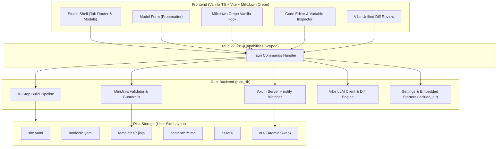

# System Patterns: Pico

## System Architecture

## State Machine & Lifecycles

### 1. Editor Lifecycle (`useCrepeEditorEffect`)
- Mounted without React/Vue wrappers into a vanilla DOM node.
- Debounced auto-save triggers 2 seconds after the user stops typing.
- On save, frontmatter is validated against the model schema, formatted into YAML headers, concatenated with clean Markdown body, and saved to disk.
- Unsaved changes flag prompts the user before switching sites or closing the application.

### 2. Template Guardrail Pattern
- Dotted variables inside `{{ ... }}` and `` (e.g. `post.author_bio`, `site.unknown`) are checked against allowed model fields and `site.yaml` properties.
- In `macros/*.jinja`, `varargs` and `kwargs` are prohibited; top-level HTML outside `` is rejected.
- On save, the previous version is backed up in memory (`AppState.template_backups`) and on disk (`.pico_history/templates/`).
- One-click Revert restores the exact previous version without requiring Git.

### 3. Atomic Build Pipeline Pattern (§6)
- Compilation always builds into `out.tmp/`.
- If any validation or render errors occur, `out.tmp/` is purged and errors are reported to the GUI with file and line. The previous working `out/` folder is left untouched.
- On success, `out.tmp/` is atomically renamed or swapped into `out/`.

### 4. Zero-Dependency Embedded Starters Pattern
- `static EMBEDDED_STARTERS: Dir = include_dir!("$CARGO_MANIFEST_DIR/../starters")`.
- `create_site_impl` checks disk directory first; if absent (standalone distributed binary), it extracts from embedded memory into the target directory.
